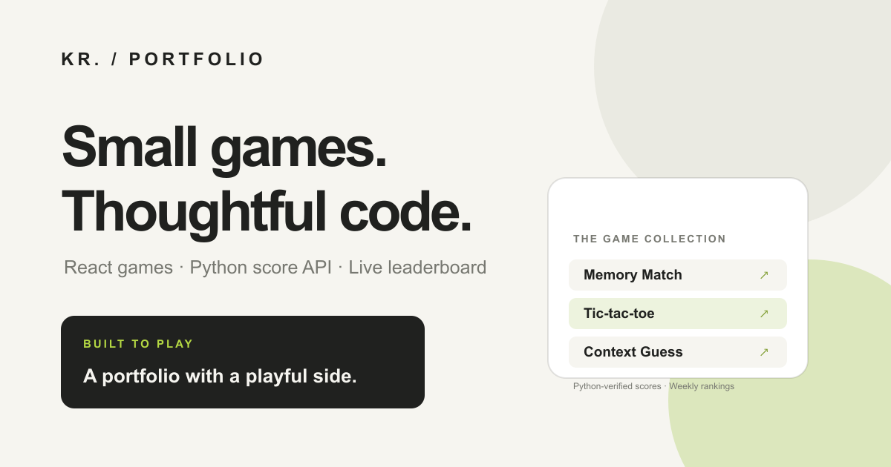

# Krish Raut — Portfolio & Browser Games



**Live site:** [krishraut997-cloud.github.io/thwebkris](https://krishraut997-cloud.github.io/thwebkris/)

A personal portfolio and small collection of playable browser games. The Python score API verifies game sessions, keeps guest history private to the browser, and saves signed-in player scores to the leaderboard.

The site uses a clean white design with subtle motion. Weekly and all-time
leaderboards and completed-game counts refresh every 15 seconds while the tab
is visible.

## Tech stack

- React, Vite, and Tailwind CSS
- Interactive Python lessons powered by Pyodide and CodeMirror
- Python and FastAPI
- SQLite for local development; PostgreSQL for production
- Firebase Authentication for optional player profiles

## Run locally

1. Install Node.js and Python, then install the project dependencies:

   ```powershell
   npm install
   python -m venv .venv
   .\.venv\Scripts\Activate.ps1
   python -m pip install -r requirements-dev.txt
   ```

2. Copy `.env.example` to `.env.local`. Set the four `VITE_FIREBASE_*` values for Google sign-in and enable Google Authentication for `localhost` in Firebase. Games can still be played without signing in.

3. Start the Python score API and the Vite app in separate terminals:

   ```powershell
   npm run dev:score-api
   ```

   ```powershell
   npm run dev
   ```

   The local score database is created at `data/game-tracker.sqlite3`.

4. Create a production build:

   ```powershell
   npm run build
   ```

The interactive Python course is available at `/python-course/` in the portfolio.
Sign in to sync course progress across devices and use the private learner
dashboard. Course progress is stored by the authenticated Python tracker in the
same database as game data; learners can access their own progress and only the
verified course owner can view the learner dashboard.
Run `npm test` to validate all course reference solutions.

See [FIREBASE_SETUP.md](./FIREBASE_SETUP.md) for authentication and production database configuration.

See [ADSENSE_SETUP.md](./ADSENSE_SETUP.md) for AdSense hosting, publisher,
consent, and deployment requirements. Ad loading remains disabled until
consent setup is confirmed in the deployment configuration.
